# Hi 👋, I'm Ahmed

### University student, full-stack developer, and hardware tinkerer building under **Utopia Tech**.

I like building practical systems that solve real problems, from education platforms and web apps to embedded AI devices and DIY gadgets. I move between React and TypeScript on the web side and ESP32 / Raspberry Pi on the hardware side, and I learn best by building things.

  
  
  
  

  

---

## 🔭 What I'm working on right now

| Project | What it is | Stack |
|---|---|---|
| 🎵 **[CYD iPod](https://github.com/AhmadTchnology/Ipod_DIY)** | An iPod-style music player on the ESP32-2432S028 "Cheap Yellow Display": SD card library, now-playing screen, Bluetooth earphone output, and a battery-saving settings tab | C++, ESP32, TFT_eSPI |
| 🕹️ **PSP YouTube Client** | Homebrew YouTube app for the PSP, backed by a one-click PC relay server that transcodes video to PSP-native H.264 | Python, yt-dlp, ffmpeg, C |
| 📻 **[uTune Jukebox](https://github.com/AhmadTchnology/uTune-Jukebox)** | A physical jukebox: tap an RFID card that stores a YouTube link and the track joins the queue | Python, Pygame, mpv, SQLite |
| 🕶️ **[Smart Assistive Glasses](https://github.com/AhmadTchnology/Deaf_AI_Glasses)** | Wearable assistive device for deaf, mute, and blind users with sign and speech recognition running on a Raspberry Pi 5 | Python, LSTM, MediaPipe, Pygame |
| 📚 **[Lecture Management System](https://github.com/AhmadTchnology/Lectures_System_Web)** | A platform for universities to manage and deliver lectures | React, TypeScript, Firebase, Cloudflare R2 & Tunnel |

## 🧪 More things I've built or am exploring

- 🎸 **Air Guitar Gloves**: flex sensors and an IMU trigger real guitar samples from hand gestures (Raspberry Pi Zero 2 W + I2S DAC)
- 🚗 **MeshRide**: an offline BLE-mesh ride-sharing concept for taxi and delivery matching, with no accounts or central servers
- 🎧 **MidTune**: an Android music player (OuterTune fork) with Spotify playlist import via OAuth PKCE
- 🗂️ **ESP32-S3 RFID storage device**: a 5" SPI screen, an RFID reader, and SD storage in one gadget
- 🧊 **Blender**: procedural 3D scenes built from code

## 🛠️ Languages & Tools

**Web**

**Backend, data & cloud**

**Embedded, hardware & systems**

**Mobile, games & 3D**

---

## 📈 Contribution graph

<picture>
  <source media="(prefers-color-scheme: dark)" srcset="https://raw.githubusercontent.com/AhmadTchnology/AhmadTchnology/output/pacman-contribution-graph-dark.svg">
  <source media="(prefers-color-scheme: light)" srcset="https://raw.githubusercontent.com/AhmadTchnology/AhmadTchnology/output/pacman-contribution-graph.svg">
  
</picture>

## 📫 Get in touch

Email: **ahmadalkirsan@gmail.com** · Portfolio and all projects: **[ahmedtech.engineer](https://ahmedtech.engineer/)**

⭐️ *Always learning, always building.*
