

<a href="https://linkedin.com/in/ahmed-technology">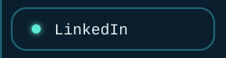</a><a href="https://instagram.com/ahmad_technology">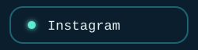</a><a href="https://ahmedtech.engineer/">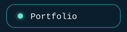</a><a href="mailto:ahmadalkirsan@gmail.com">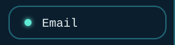</a>
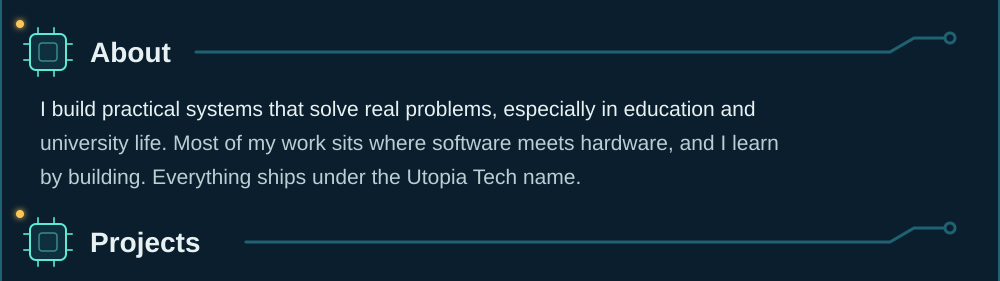
<a href="https://github.com/AhmadTchnology/Ipod_DIY">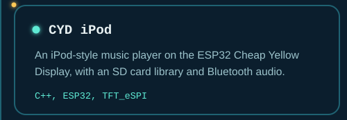</a><a href="https://github.com/AhmadTchnology/uTune-Jukebox">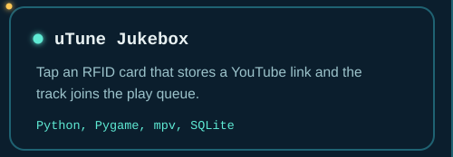</a>
<a href="https://github.com/AhmadTchnology/Deaf_AI_Glasses">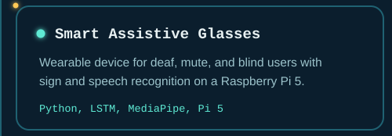</a><a href="https://ahmedtech.engineer/">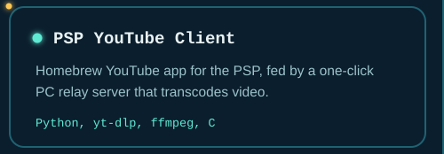</a>
<a href="https://ahmedtech.engineer/">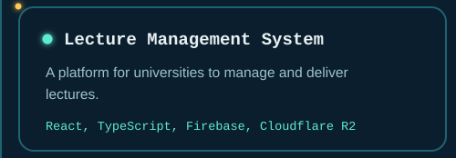</a><a href="https://ahmedtech.engineer/">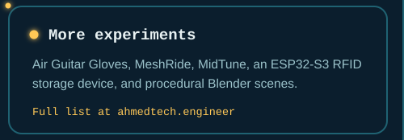</a>
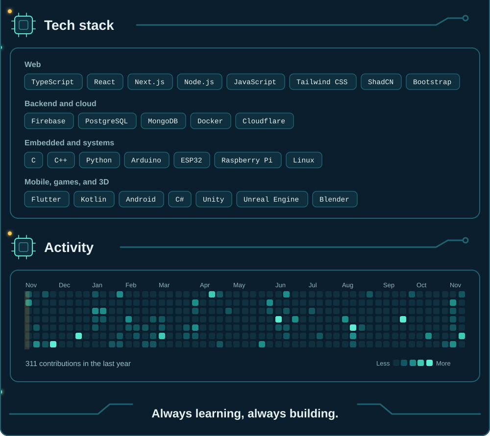

