## About me

I'm a university student who likes building practical systems that solve real problems, especially in education and university settings. I work across software and hardware: web apps in React and TypeScript on one side, ESP32 and Raspberry Pi devices on the other. I learn by building, and I ship under the **Utopia Tech** name.

## Now building

  

 

| Project | Repo | Stack |
|---|---|---|
| CYD iPod | [Ipod_DIY](https://github.com/AhmadTchnology/Ipod_DIY) | C++, ESP32, TFT_eSPI |
| uTune Jukebox | [uTune-Jukebox](https://github.com/AhmadTchnology/uTune-Jukebox) | Python, Pygame, mpv, SQLite |
| Smart Assistive Glasses | [Deaf_AI_Glasses](https://github.com/AhmadTchnology/Deaf_AI_Glasses) | Python, LSTM, MediaPipe, Raspberry Pi 5 |
| PSP YouTube client | coming soon | Python, yt-dlp, ffmpeg, C |
| Lecture Management System | [ahmedtech.engineer](https://ahmedtech.engineer/) | React, TypeScript, Firebase, Cloudflare R2 and Tunnel |

<b>More projects and experiments</b>

 

- **Air Guitar Gloves**: flex sensors and an IMU trigger real guitar samples from hand gestures, running on a Raspberry Pi Zero 2 W with an I2S DAC
- **MeshRide**: an offline BLE-mesh ride-sharing concept for taxi and delivery matching, with no accounts or central servers
- **MidTune**: an Android music player forked from OuterTune, with Spotify playlist import through OAuth PKCE
- **ESP32-S3 RFID storage device**: a 5" SPI screen, an RFID reader, and SD storage in one gadget
- **Blender**: 3D scenes built procedurally from code

## Tech stack

 

## GitHub stats

<picture>
  <source media="(prefers-color-scheme: dark)" srcset="https://raw.githubusercontent.com/AhmadTchnology/AhmadTchnology/output/pacman-contribution-graph-dark.svg">
  <source media="(prefers-color-scheme: light)" srcset="https://raw.githubusercontent.com/AhmadTchnology/AhmadTchnology/output/pacman-contribution-graph.svg">
  
</picture>

## Get in touch

Email me at **ahmadalkirsan@gmail.com**, or see everything I've built at **[ahmedtech.engineer](https://ahmedtech.engineer/)**.

*Always learning, always building.*

